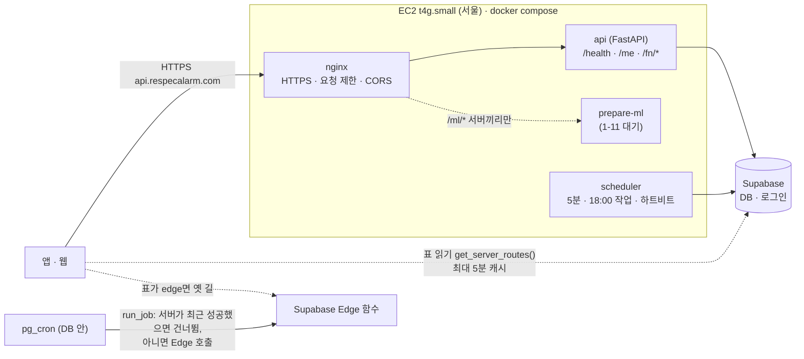

# respec-server

Re:Spec Alarm 서버(FastAPI · EC2). Supabase Edge 함수가 하던 알람 계산을 서버로 옮기는 중이고, **어디서 돌지는 DB 표 한 줄(`server_routes`)로 정함** — 값은 지금 전부 `edge`(옛 길 그대로), 언제든 `edge`로 되돌림.

| 보고 싶은 것 | 문서 |
|---|---|
| 로컬에서 띄우기(서버 + 격리 Supabase + 로그인 토큰) | [`docs/local-dev.md`](docs/local-dev.md) |
| 이상이 생겼을 때 되돌리기 · SQL · 데모 전날 점검표 | [`docs/runbook.md`](docs/runbook.md) |
| 서버(EC2)를 처음부터 다시 세우기 | [`deploy/server-setup.md`](deploy/server-setup.md) |
| AWS를 전부 끊는 순서 | [`docs/종료_런북.md`](docs/종료_런북.md) |
| 서버 코드 설명(토큰 검사 · 오류 모양 · 스케줄러 · 설정 이름) | [`api/README.md`](api/README.md) |
| Edge와 서버 결과 대조 시험 | [`dev/contract/README.md`](dev/contract/README.md) |

설계 · 결정 기록은 본 레포(`respec-alarm-capstone`) `docs/서버_*_1112.md`.

## 1. 구조



- **스위치 표** `public.server_routes (kind, name, mode)`: 함수 줄(앱이 부르는 Edge 함수) = `edge` · `canary`(지정 계정만) · `server`, 작업 줄(예약 작업) = `edge` · `shadow`(세기만) · `server`. 앱은 호출 때 표를 보고 Edge · 서버 중 고르고(읽기 함수는 서버가 못 쓸 상태면 자동으로 Edge), pg_cron은 서버가 멈추면 Edge로 이어받음. 표를 못 읽으면 전부 `edge`.
- **scheduler**는 api와 같은 이미지에 시작 명령만 다름. 1분마다 `server_heartbeat.alive_at`을 갱신하고(`/health/deep`이 15분 넘게 멈추면 감시 메일), 작업 줄이 `shadow` · `server`인 작업만 함.
- 서버가 부르는 곳: Supabase(DB · 로그인 공개 키), 카카오(장소 · 길찾기), Expo Push(푸시 모듈). 비밀값은 서버 env 파일에만(`/srv/respec/*.env`, 이름 목록 = `.env.example`).
- 예측 켜기 값(`PREPARE_ML_ENABLED` · `_ALLOWED_USER_IDS` · `_CODEBOOK_VERSION`)은 서버 전용 설정 표 `server_settings`로 옮기는 중(2-3, 서버 PR 대기). 지금 서버는 예측을 안 부름(`prepare-ml`이 안 떠 있음, 1-11 대기).

## 2. 배포 길

```text
PR 머지(main) ──(api/** · deploy/** · .env.example 변경일 때만)──▶ Actions deploy.yml
   └ arm64 이미지 2개를 GHCR에: respec-api:<sha-7자리> · respec-deploy:<sha-7자리>(compose · versions · env.example 묶음)
   └ SSH(deploy 계정, 강제 명령)로 "deploy sha-…" 한 줄
        서버 deploy.sh: 묶음 받기 → 점검(compose 문법 · 정책 · env 이름) → 교체(up -d --wait)
                        → 배포 직후 점검(/health 버전 · /me 401 · OPTIONS 204 · 시험 계정 /me 200)
                        통과 = 이 버전을 마지막 정상으로 기록 / 실패 = 직전 정상 버전으로 자동 되돌림
```

- 켜고 끄는 스위치: 레포 Variable `DEPLOY_ENABLED`(`true`일 때만 배포). `docs/**` · README만 바꾸면 배포가 안 돎.
- 배포는 한 번에 하나(서버 잠금) — 연달아 머지하면 순서대로. SSH가 끊겨도 서버에서 끝까지 돎.
- **PC 길**(Actions가 막혔을 때): `deploy/build-push.sh`(PC에서 arm64 빌드 → GHCR → 같은 `deploy` 명령). 11/15에 실제로 한 번 돌려 통과. 절차 `docs/runbook.md` 3절.
- nginx · 배포 스크립트 · bootstrap은 root 소유라 **배포로는 안 바뀜** — 바꾸는 PR은 "서버 반영: 필요"를 적고 `bootstrap.sh`를 다시 돌림(`deploy/server-setup.md` 8절).
- 현재 배포 태그 = `curl -s https://api.respecalarm.com/health`의 `version`.

## 3. 되돌리기

| 무엇 | 어떻게 | 걸리는 시간 |
|---|---|---|
| 앱 → 서버 함수 | `update public.server_routes set mode = 'edge' where kind = 'function' and name = '…'` (전부면 `where mode <> 'edge'`) | 앱이 표를 다시 읽을 때(최대 5분) |
| 예약 작업 | 같은 표의 `kind = 'job'` 줄을 `edge`로 | 다음 회차(5분 안) |
| pg_cron 명령(M1) | 원복 SQL(`supabase/ops/server-switch-rollback.sql`, 본 레포) · 다시 적용 SQL | 즉시 · 확인 20분 안 |
| 서버 이미지 | `ssh deploy@서버 rollback`(마지막 정상) 또는 `deploy sha-<이전>`(한 칸 전). 배포 실패는 자동 | 약 30 ~ 40초 |
| 서버가 멈춤 | pg_cron이 알아서 Edge로 이어받음(최악 약 17분, 문서에는 "20분 안") | — |

SQL 전문 · 확인 방법 · 이어받기 시간표 · 데모 전날 점검표는 [`docs/runbook.md`](docs/runbook.md). 서버를 새로 세우거나 끊는 일은 `deploy/server-setup.md` · `docs/종료_런북.md`.

## 4. 함수별 담당

Edge 함수 20개 중 8개를 서버로 옮김(모두 main 머지 · 배포됨). **현재 모드는 운영 `server_routes`를 읽기만 해서 확인한 값**(11/15 18:39 KST, `canary` 대상 계정 0명).

| Edge 함수 | 서버 쪽 | 스위치 키 `(kind, name)` | 현재 모드 |
|---|---|---|---|
| `place-search` | `POST /fn/place-search` | `function · place-search` | `edge` |
| `place-reverse` | `POST /fn/place-reverse` | `function · place-reverse` | `edge` |
| `alarm-suggest` (미리보기) | `POST /fn/alarm-suggest` | `function · alarm-suggest` | `edge` |
| `alarm-commit` (저장) | `POST /fn/alarm-commit` | `function · alarm-commit` | `edge` |
| `alarm-roll` (앱이 부름) | `POST /fn/alarm-roll` | `function · alarm-roll` | `edge` |
| `appointment-edit` (수정 · 삭제 · 복원 · 나가기) | `POST /fn/appointment-edit` | `function · appointment-edit` | `edge` |
| `alarm-roll` (5분마다 반복 회차) | scheduler | `job · alarm-roll` | `edge` |
| `wake-check` (5분마다 기상 확인) | scheduler | `job · wake-check` | `edge` |
| `suggestion-generate` (매일 18:00 KST 제안) | scheduler | `job · suggestion-generate` | `edge` |

옮기지 않은 것(정할 일 0-8 대기 포함):

| Edge 함수 | 상태 |
|---|---|
| `notify` | 안 옮김 확정(푸시는 따로 담당, 11/14) |
| `account-delete` | 안 옮김 확정(계정은 Supabase 담당, 11/14) |
| `alarm-suggest-ml-test` | 안 옮김(개발용) |
| `suggestion-apply` | 목록 밖 — 정할 일, 스위치 줄 없음 |
| `voice-session` · `voice-turn` · `voice-commit` · `voice-live-token` · `alarm-briefing` · `timetable-extract` · `briefing-device` · `alarm-briefing-device` | AI 8개, 0-8 대기(AI 담당) |

DB 안 예약 작업(`voice-auto-commit` · `friend-requests-expire` · `friend-records-purge`)은 M1이 안 건드려 그대로. 코드 위치는 `api/app/routers/`(경로) · `api/app/jobs*.py`(예약 작업) · 시험은 `api/tests/` + `dev/contract/`.

## 5. 측정값

이미 잰 값만(날짜 · 출처). 없는 칸은 "테스트 기간에 잼".

| 항목 | 값 | 날짜 · 출처 |
|---|---|---|
| 서버 | t4g.small(2 vCPU · 메모리 2GB) · swap 2GB · gp3 20GiB | 11/14 U5 |
| 컨테이너 메모리 | api 46MiB(한도 300) · scheduler 31MiB(한도 256). 서버 전체 사용 694MB / 1,834MB, swap 0 | 11/15 `docker stats` · `free` |
| 메모리 합계 ≤ 1.1GB(예측 서버 포함) · 24시간 뒤 swap | **테스트 기간에 잼**(예측 서버 1-11 뒤) | — |
| 디스크 | 5.5GB / 19GB(30%) | 11/15 `df` |
| 이미지 크기 | 258MB(api · scheduler 공용) | 11/15 `docker images` |
| `/health` 응답 | 서버 안 p50 8ms(10회) · PC에서 HTTPS p50 34ms · 최대 120ms(10회) | 11/15 |
| `/health/deep` 응답 | 94 ~ 179ms(3회, 공개 키 · DB · 스케줄러 확인 포함) | 11/15 |
| 함수 p95 (Edge 대비) · 카카오 일 사용량 · CPU 크레딧 잔량 | **테스트 기간에 잼** | — |
| 배포 시간 | Actions 76 ~ 111초(최근 8회 중 7회, 앞 배포를 기다린 1회는 157초) · 서버에서 `deploy` 35 ~ 38초(PC 길 38초 포함) | 11/15 Actions 기록 · `deploy.log` |
| 이미지 되돌리기 | 한 칸 전 32초 · 복귀 30초(교체 순간 `/health` 약 2초 502) | 11/15 실서버 |
| 재부팅 복구 | SSH 19초 · 컨테이너 30초 · HTTPS `/health` 26초(기준 180초) | 11/15 1-13 ④ |
| 감시 | api 정지 → 10분 안 메일 · 스케줄러 15분 정체 → 메일 3~4분 안(5분 주기) · 복구 메일 확인 | 11/15 UptimeRobot |
| 인증서 | 만료 2027-02-12(자동 갱신, `certbot.timer`) | 11/15 `certbot certificates` |
| 시험 | api pytest 1113 통과(1 건너뜀) · deploy 시험 5묶음(check-env 30 · smoke 38 · deploy 140 · compose 78 · nginx 99) · 계약 시험(Edge ↔ 서버) 230경우 중 227 같음 — 다른 3은 401 본문 모양(알려진 차이, `dev/contract/README.md`) | 11/15 |
| 로컬에서 처음부터 띄우기 | 새 폴더에서 문서대로 64초(레포 받기 8 · pytest 14 · prepare 5 · Supabase start 28 · env 3 · 서버 1 · check 4, 캐시 있는 상태). 처음 하는 PC는 이미지 받기로 몇 분 더 | 11/15 `docs/local-dev.md` |

## 개발

```bash
cd api && uv sync && uv run pytest                       # 서버 시험
bash deploy/tests/run.sh                                  # 배포 스크립트 · compose · nginx 시험(CI와 같음)
```

`deploy/tests/run.sh`는 bash(Windows는 Git Bash)와 Docker가 필요함. `shellcheck`가 없으면 정적 분석은 건너뛰고 CI에서 돎. 로컬 Supabase · 로그인 토큰까지 띄우는 순서는 [`docs/local-dev.md`](docs/local-dev.md).
